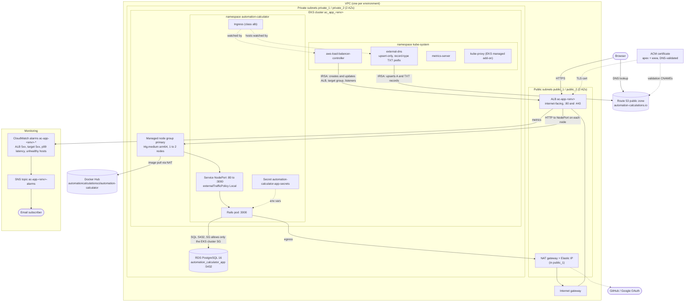
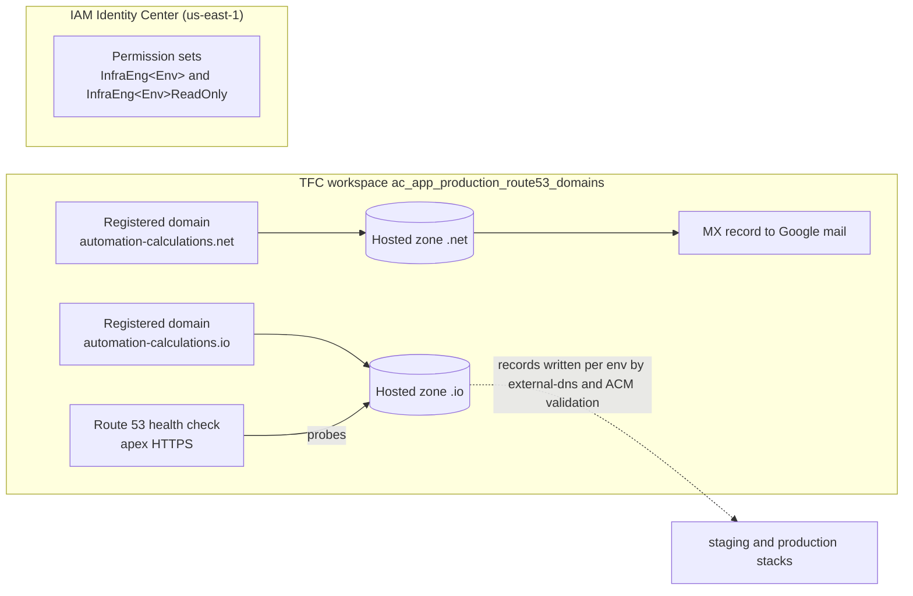
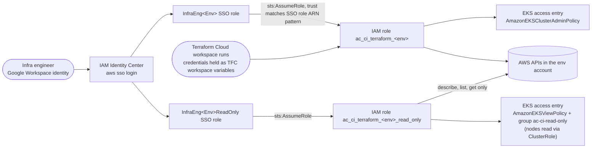
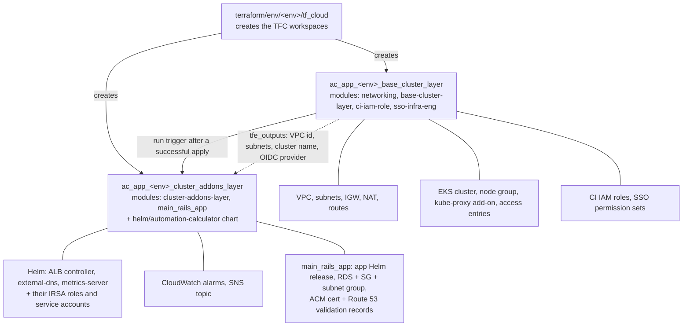
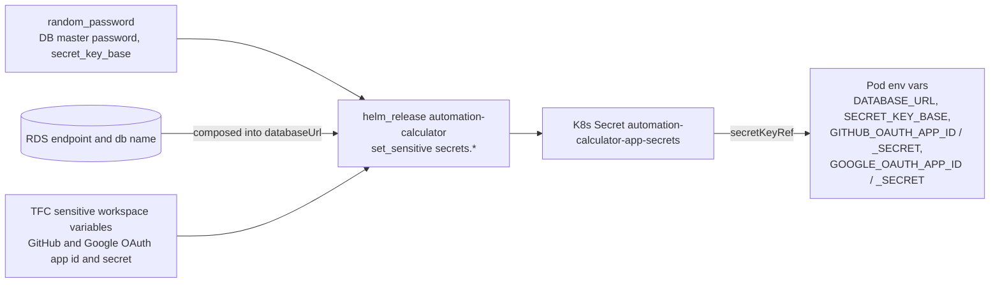

# AWS resources and how they connect

## Per-environment stack (`us-west-1`, staging and production)

Staging and production are identical apart from the hostname: `staging.automation-calculations.io` and `automation-calculations.io`.

Key elements:

- **Nodes and RDS are private.** Only the ALB and the NAT gateway live in the public subnets. Nodes reach Docker Hub and the OAuth providers through the single NAT gateway.
- **The ALB is not a Terraform resource.** The aws-load-balancer-controller creates it from the app's Ingress annotations (`load-balancer-name: ac-app-<env>`, `target-type: instance`, `certificate-arn` from ACM). The CloudWatch alarms find it and its target group by name and tags.
- **DNS records for the app hostnames are written by external-dns**, not Terraform. external-dns runs with `policy: upsert-only`, so it never deletes records. Terraform writes only the ACM validation records.
- **IRSA**: the controller and external-dns each assume their own IAM role (`<env>_eks_lb`, `<env>_eks_external_dns`) through the cluster's OIDC provider. No static AWS keys are used in the cluster.

## Global resources (`us-east-1`, production account)

The permission sets are created by each environment's `base_cluster_layer` workspace through module `sso_infra_eng`, which uses a `us-east-1` provider alias.

## Who can touch what: human and CI access

There are no IAM users or access keys for humans. Local `AWS_PROFILE`s chain SSO into the CI roles; see [docs/aws-sso-auth.md](../aws-sso-auth.md).

## Terraform layers and what each owns

## How secrets reach the pod (key names only)

Values live only in Terraform state, TFC workspace variables, and the cluster Secret. `helm/automation-calculator/values.yaml` holds placeholders.
