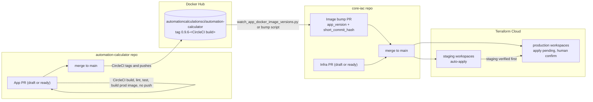
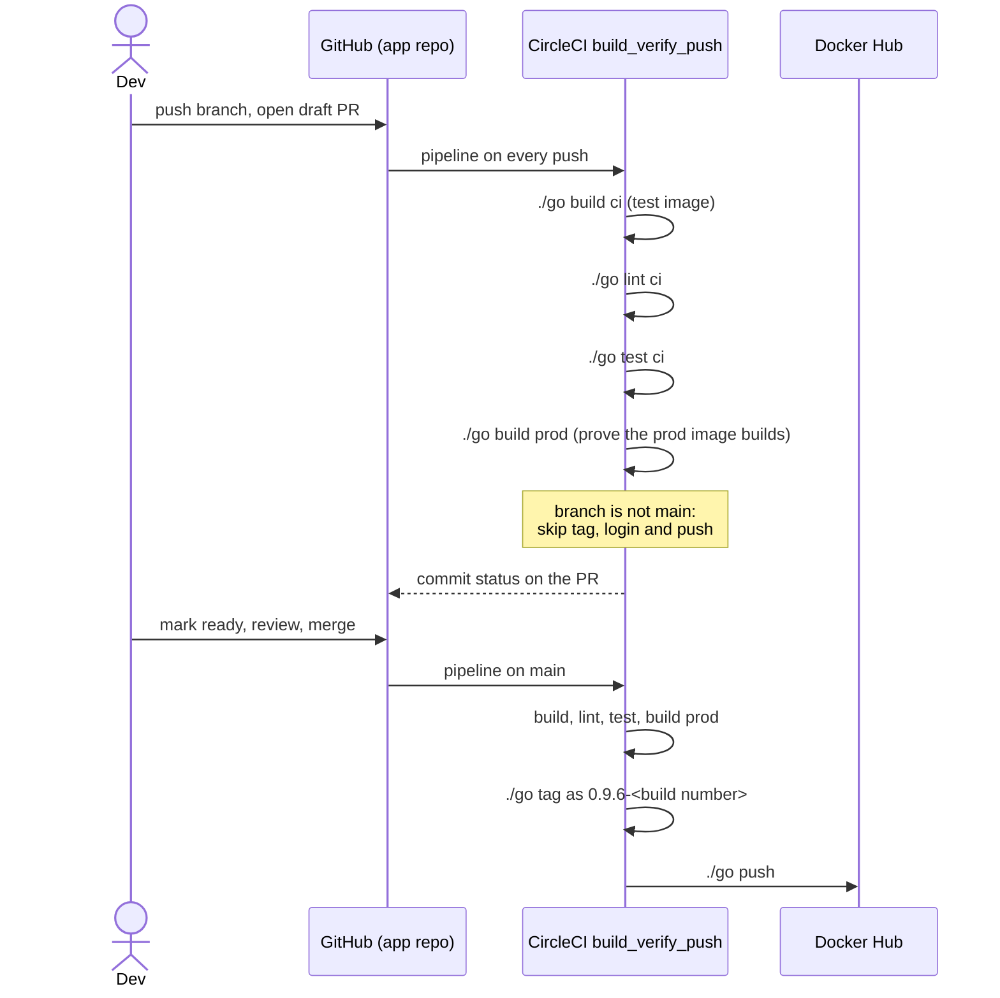
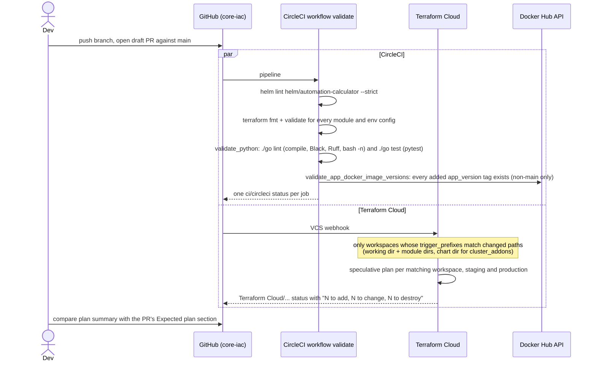
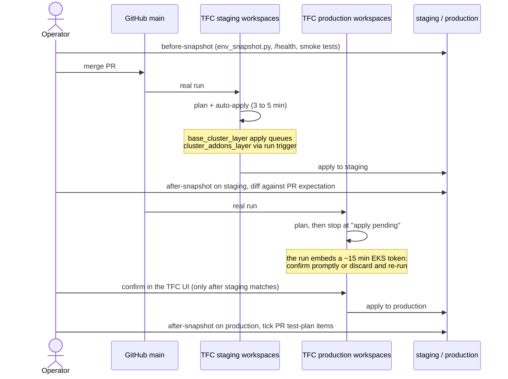

# How app and infra code is validated and deployed

**Nothing deploys from a draft PR.** A draft PR, or any PR, only runs validation:

- CircleCI checks.
- Terraform Cloud **speculative** plans, posted as commit statuses.

The only thing that changes an environment is merging to `main` in this repo. The app repo's `main` publishes an image, but that image reaches a cluster only through a core-iac PR.

## End to end

## App PR (automation-calculator repo)

Branch builds never publish a tag shaped like `0.9.6-<n>`, because every such tag becomes a deploy PR in core-iac.

## Infra PR validation (this repo)

Notes:

- **The plan runs regardless of draft state.** A draft gets the same speculative plans as a ready PR. Plans are never applied.
- **Stacked PRs whose base is not `main` get CircleCI only.** Terraform Cloud plans only PRs against the workspace's branch, `main`.
- **Docs-only or scripts-only PRs get no Terraform Cloud status.** No workspace `trigger_prefixes` match their paths.

Which workspace a path triggers:

| Changed path | Workspace(s) planned |
|---|---|
| `terraform/env/<env>/aws/us-west-1/base-cluster-layer`, `modules/aws/networking`, `modules/aws/base-cluster-layer` | `ac_app_<env>_base_cluster_layer` |
| `terraform/env/<env>/aws/us-west-1/cluster-addons-layer`, `modules/aws/cluster-addons-layer`, `modules/aws/main_rails_app`, `helm/automation-calculator` | `ac_app_<env>_cluster_addons_layer` |
| `terraform/env/production/aws/us-east-1/route53-domains` | `ac_app_production_route53_domains` |
| `terraform/env/production/github/org`, `modules/github/org-ci-access` | `ac_app_production_github_org` |

## Merge and promotion

The operator steps are run by the `deploy-image` skill (image bumps) and the `validate-infra-rollout` skill (Terraform and Helm changes), both in `.claude/skills/`. The helper scripts they call live in `scripts/`:

- `wait_commit_status.py`
- `env_snapshot.py`
- `pr_checklist.py`
