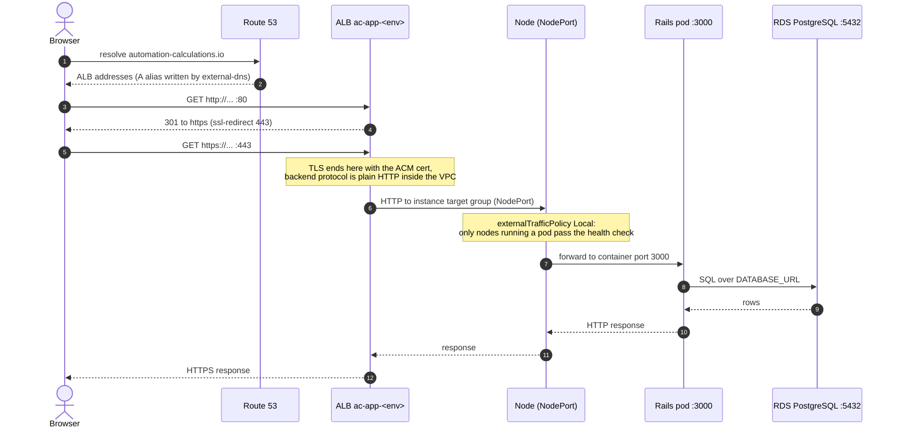
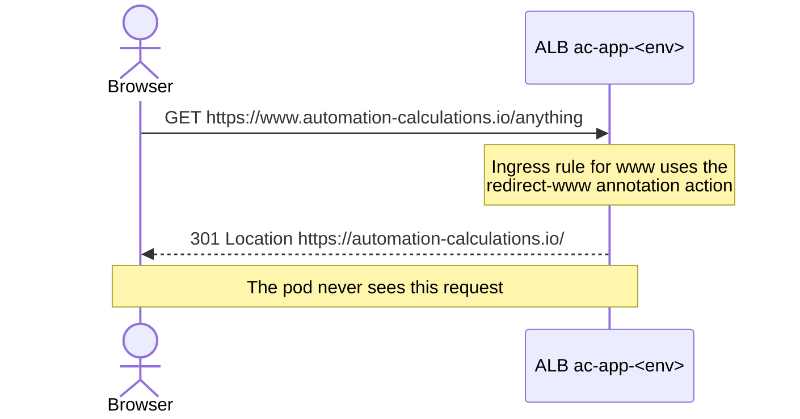
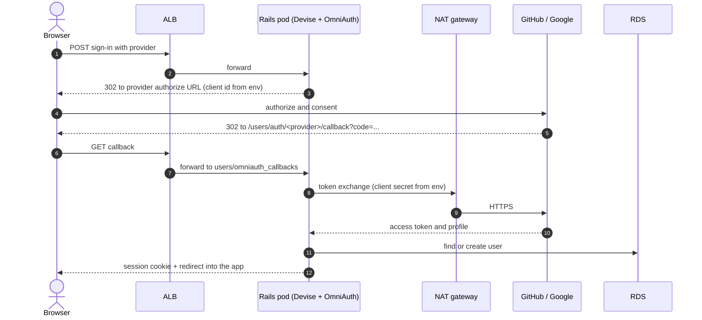
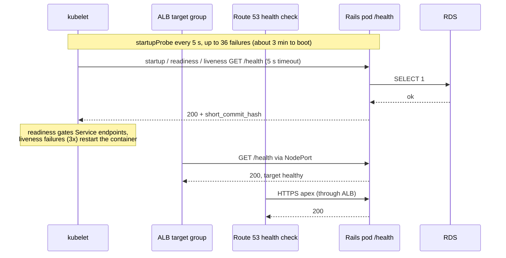
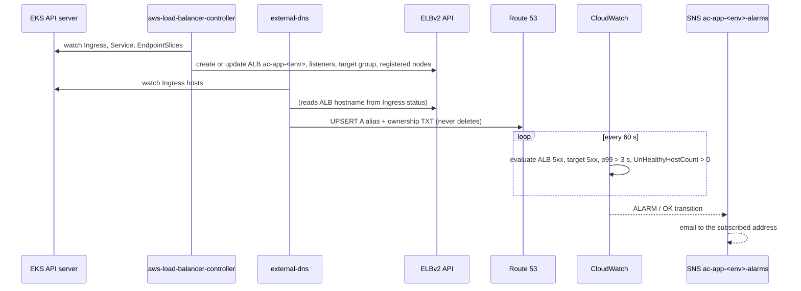

# Request and response flows

The diagrams use the production hostname. Staging is the same with `staging.` in front of it.

## Page request

Key elements:

| Hop | Element | Defined in |
|---|---|---|
| DNS | A alias for the host, ownership TXT with a record-type prefix | external-dns (`cluster-addons-layer/main.tf`) |
| TLS | ACM cert for the apex and `www`, listeners on `:80` and `:443`, ssl-redirect | `main_rails_app/main.tf`, `main_rails_app/values.yml` |
| Routing | Ingress host rule `/*` to the Service, ALB `target-type: instance` | `helm/automation-calculator/templates/ingress.yaml` |
| Service | `NodePort` port 80 to targetPort 3000 | `templates/service.yaml` |
| DB | SG allows 5432 only from the EKS cluster security group | `main_rails_app/main.tf` |

## `www` redirect

## OAuth sign-in (GitHub or Google)

The OAuth client secrets reach the pod as env vars from the Kubernetes Secret. See [aws-resources.md](aws-resources.md#how-secrets-reach-the-pod-key-names-only).

## Health checks

Every check hits the same endpoint. `GET /health` runs `SELECT 1` against the database and returns JSON that includes `short_commit_hash`, which is how a rollout is detected from outside the cluster.

## Control loops that keep the edge in sync

These run continuously, independent of user traffic.

